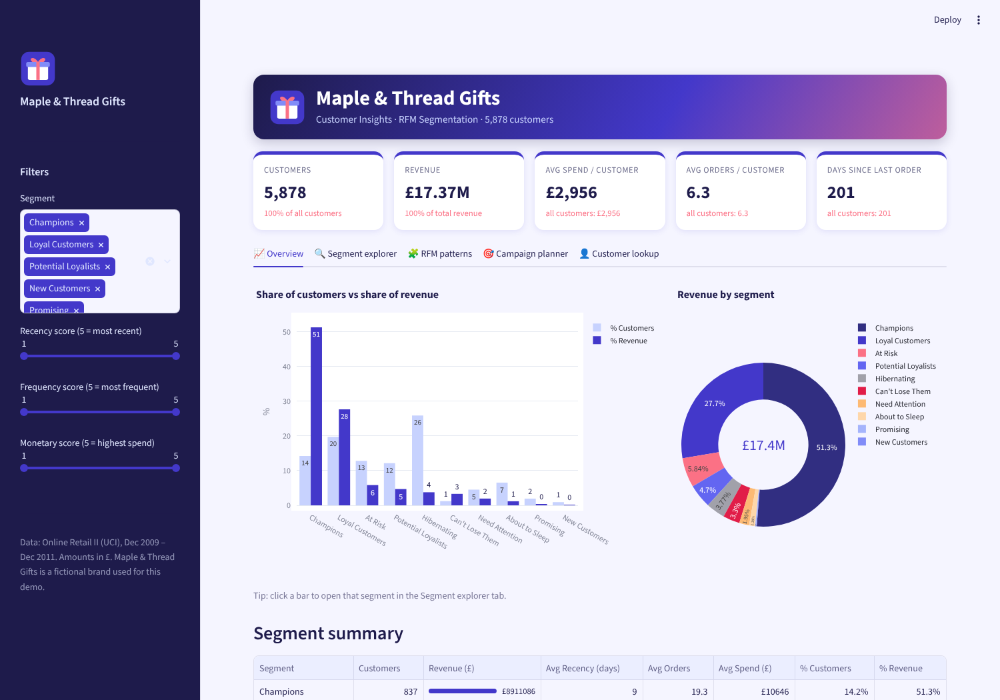
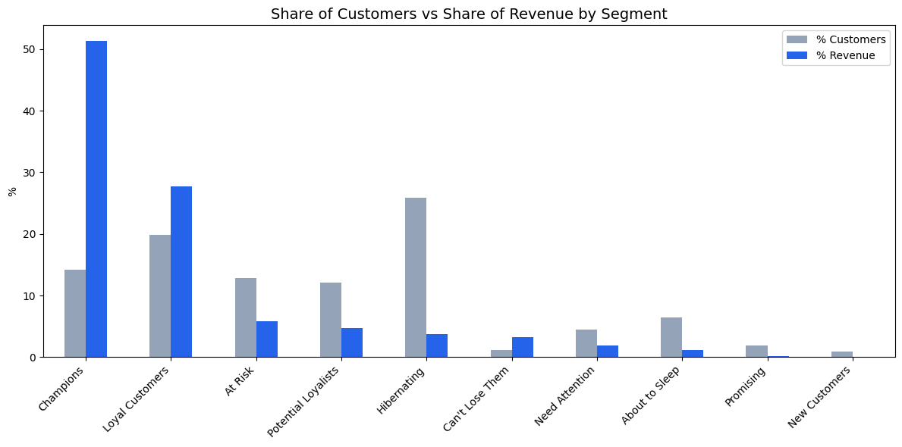
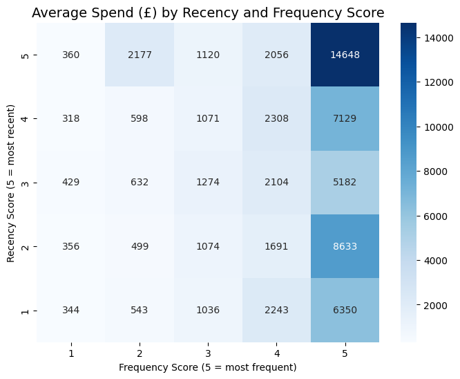
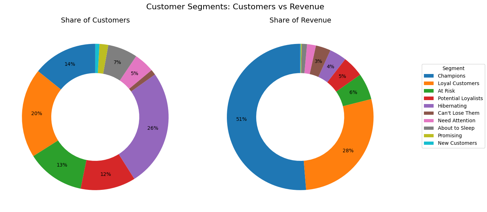

# Customer Segmentation Using RFM Analysis

**🔗 Live dashboard:** [https://rfm-customer-segmentation-5tox6mjhezoczba3wgd24e.streamlit.app/](https://rfm-customer-segmentation-5tox6mjhezoczba3wgd24e.streamlit.app/)

[](https://rfm-customer-segmentation-5tox6mjhezoczba3wgd24e.streamlit.app/)

[](https://rfm-customer-segmentation-5tox6mjhezoczba3wgd24e.streamlit.app/)

## Project Overview
Not all customers are equally valuable. This project scores the 5,878 customers of a UK online gift retailer on **Recency, Frequency and Monetary value (RFM)**, groups them into 10 behavioural segments, and recommends a marketing action for each segment. The results are explored in an interactive **Streamlit dashboard**.

## Dataset
- **Source:** [Online Retail II](https://archive.ics.uci.edu/dataset/502/online+retail+ii), UCI Machine Learning Repository
- **Size:** 1,067,371 transactions × 8 columns
- **Period:** 1 December 2009 – 9 December 2011
- **Currency:** British pounds (£)

The raw dataset is not included in this repository because of its size (about 90 MB). Download it from the link above to rerun the notebook.

## Tools
Python · Pandas · Matplotlib · Seaborn · Plotly · Streamlit · Google Colab

## Data Cleaning
| Step | Rows remaining | Rows removed |
|---|---|---|
| Raw data | 1,067,371 | |
| Remove rows with no Customer ID | 824,364 | 243,007 |
| Remove cancelled invoices (start with "C") | 805,620 | 18,744 |
| Remove zero or negative quantity and price | 805,549 | 71 |
| Remove duplicate rows | 779,425 | 26,124 |

**Result:** 779,425 clean transactions from **5,878 customers**. Customer IDs were also fixed (`13085.0` → `13085`), and a `TotalPrice` column (Quantity × Price) was added.

## Method
1. **Calculate RFM per customer**, using 10 Dec 2011 (the day after the last purchase) as the snapshot date
   - **Recency:** days since the last purchase
   - **Frequency:** number of separate invoices
   - **Monetary:** total amount spent
2. **Score each metric from 1 to 5** with quintiles (`pd.qcut`). Recency is reversed so that recent buyers score 5.
3. **Assign segments** using the R and F scores:

| Segment | Rule |
|---|---|
| Champions | R = 5, F ≥ 4 |
| Loyal Customers | R ≥ 3, F ≥ 4 |
| Potential Loyalists | R ≥ 4, F = 2–3 |
| New Customers | R = 5, F = 1 |
| Promising | R = 4, F = 1 |
| Need Attention | R = 3, F = 3 |
| About to Sleep | R = 3, F ≤ 2 |
| Can't Lose Them | R ≤ 2, F = 5 |
| At Risk | R ≤ 2, F = 3–4 |
| Hibernating | everyone else |

## Results
| Segment | Customers | % Customers | Revenue | % Revenue |
|---|---|---|---|---|
| Champions | 837 | 14.2% | £8,911,086 | 51.3% |
| Loyal Customers | 1,161 | 19.8% | £4,805,173 | 27.7% |
| At Risk | 753 | 12.8% | £1,015,248 | 5.8% |
| Potential Loyalists | 714 | 12.1% | £815,892 | 4.7% |
| Hibernating | 1,523 | 25.9% | £654,427 | 3.8% |
| Can't Lose Them | 71 | 1.2% | £574,136 | 3.3% |
| Need Attention | 266 | 4.5% | £338,799 | 1.9% |
| About to Sleep | 385 | 6.5% | £204,350 | 1.2% |
| Promising | 114 | 1.9% | £36,267 | 0.2% |
| New Customers | 54 | 0.9% | £19,426 | 0.1% |







## Key Insights
1. **Revenue is highly concentrated.** Champions are 14.2% of customers but generate **51.3% of revenue**. Together with Loyal Customers, **34% of customers produce 79% of revenue**.
2. **Frequency is the strongest sign of value.** Customers with the top frequency score spend £5,000–£14,600 on average, compared with about £350 for one-time buyers.
3. **Valuable customers are slipping away.** *Can't Lose Them* (71 customers averaging £8,086 and 16 orders) and *At Risk* (753 customers) have spent £1.6M in total but haven't bought for around a year.
4. **A quarter of customers are inactive.** Hibernating is the largest segment (25.9%) but contributes only 3.8% of revenue.

## Recommended Actions
| Segment | Action |
|---|---|
| Champions | VIP program, early access to new products, ask for reviews and referrals |
| Loyal Customers | Upsell higher-value products, loyalty points, personalised recommendations |
| Potential Loyalists | Membership or loyalty program, recommend related products |
| New Customers | Welcome emails, onboarding tips, discount on the 2nd order |
| Promising | Free shipping offer, highlight best-sellers |
| Need Attention | Limited-time offers based on past purchases |
| About to Sleep | "We miss you" discount on popular products |
| Can't Lose Them | **Top priority:** personal outreach, exclusive offers, find out why they left |
| At Risk | Personalised win-back emails, special discounts, ask for feedback |
| Hibernating | Low-cost re-activation; remove from regular mailing if no response |

## Interactive Dashboard (Streamlit)
**Try it live:** [https://rfm-customer-segmentation-5tox6mjhezoczba3wgd24e.streamlit.app/](https://rfm-customer-segmentation-5tox6mjhezoczba3wgd24e.streamlit.app/)

The dashboard uses **Maple & Thread Gifts**, a fictional brand created for this demo.

- **Overview:** KPIs, customers vs revenue by segment (click a bar to explore it), revenue donut, summary table
- **Segment explorer:** profile of any segment compared with all customers, plus its top 10 customers
- **RFM patterns:** heatmaps and a bubble chart of every customer
- **Campaign planner:** what-if tool that estimates responders, revenue and ROI for a campaign
- **Customer lookup:** search any customer ID and download the filtered list

The free Streamlit app goes to sleep after a few days without visits. If you see a "wake up" button, click it and wait about 30 seconds.

**Run it locally:**
```bash
pip install -r requirements.txt
streamlit run app.py
```

## Repository Contents
| File | Description |
|---|---|
| `rfm_analysis.ipynb` | Full analysis notebook (cleaning, RFM scoring, segmentation, charts) |
| `app.py` | Streamlit dashboard |
| `requirements.txt` | Packages needed for the dashboard |
| `.streamlit/config.toml` | Dashboard colour theme |
| `rfm_customers.csv` | RFM scores and segment for every customer (used by the dashboard) |
| `data/rfm_segment_summary.csv` | Summary table by segment |
| `images/` | Charts and dashboard screenshot |
